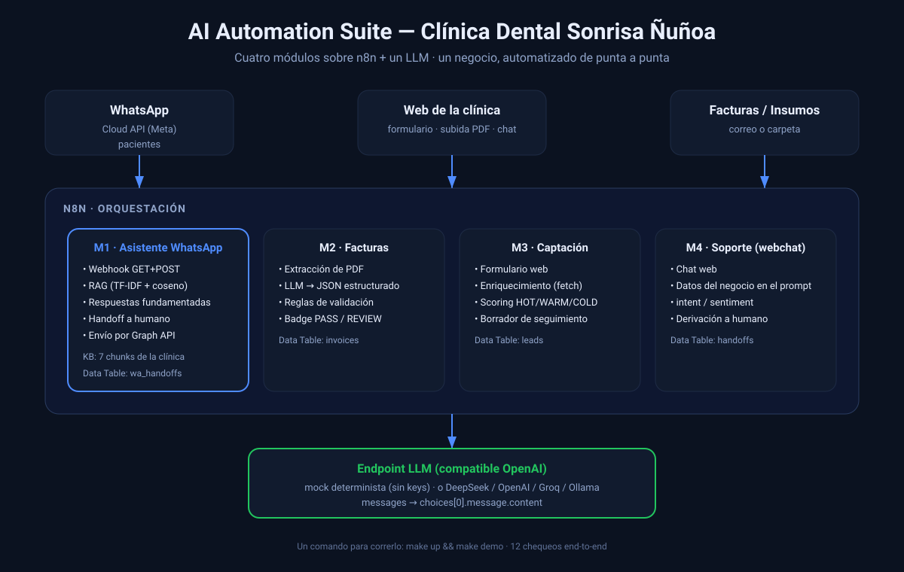
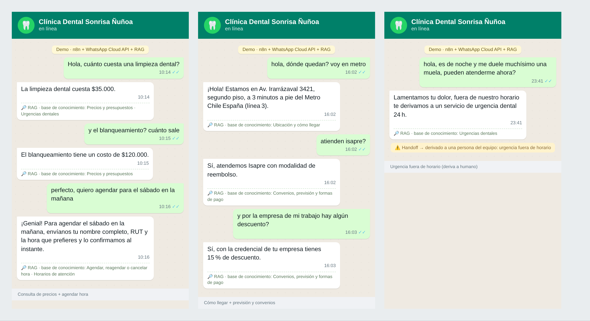

# AI Automation Suite

[](LICENSE)
[](https://n8n.io)
[](#-por-qué-un-llm-mock)
[](#-quickstart-un-comando-sin-api-keys)
[](#-por-qué-un-llm-mock)

### Automatización con IA para PyMEs — de punta a punta

Cuatro módulos de automatización **listos para producción**, construidos sobre
[**n8n**](https://n8n.io) + un **LLM** (cualquier endpoint compatible con OpenAI).

**Caso de referencia:** *Clínica Dental Sonrisa Ñuñoa* — una clínica dental que
hoy atiende todo a mano. Los 4 módulos son la suite completa que le armé.

> ⚡ Corre entero con **un comando** y **sin API keys**: el repo trae un **LLM mock
> determinista**. Para usar un modelo real (DeepSeek, OpenAI, Groq, Ollama…), cambiás
> una URL. Nada de dependencias externas.

---

## 🦷 El caso de referencia

| Dato | Valor |
|---|---|
| Rubro | Clínica dental (odontología general) |
| Nombre | Clínica Dental Sonrisa Ñuñoa |
| Tamaño | 3 odontólogos + 2 asistentes |
| Ubicación | Santiago, Chile |
| Dolor | WhatsApp a mano todo el día, facturas de insumos tipeadas a planilla, consultas de noche sin responder, cero seguimiento a pacientes nuevos |

**Antes → Después**

| Antes (a mano) | Después (con la suite) |
|---|---|
| Respondían el WhatsApp uno por uno; los mensajes de la noche se perdían | **M1** — asistente 24/7 que responde solo y deriva a una persona cuando corresponde |
| Cada factura de insumos se copiaba a mano a una planilla | **M2** — lee el PDF, valida los totales y registra el gasto solo |
| Las consultas de la web quedaban sin seguimiento | **M3** — las califica y redacta el email de seguimiento |
| El personal preguntaba todo por interno | **M4** — agente de soporte interno con la FAQ del equipo |

> La suite es **genérica**: los 4 módulos sirven para cualquier PyME (retail, servicios,
> salud, gastronomía…). La clínica es solo el ejemplo concreto que uso para demostrarlo.

---

## 🧩 Los 4 módulos

| # | Módulo | Qué hace | Doc |
|---|--------|----------|-----|
| **1** | **Asistente de WhatsApp con RAG** | Canal WhatsApp Cloud API → recuperación por relevancia (TF-IDF) sobre la base de conocimiento del negocio → respuestas **fundamentadas** + derivación a humano | [ver](docs/modulo-01-asistente-whatsapp.md) |
| **2** | **Automatización de facturas** | Sube un PDF → el LLM extrae los campos → reglas de negocio validan → planilla + reporte HTML con badge PASS/REVIEW | [ver](docs/modulo-02-facturacion.md) |
| **3** | **Captación de pacientes/leads** | Formulario → enriquecimiento (fetch del sitio) + scoring con IA (HOT/WARM/COLD) → registro + borrador de seguimiento | [ver](docs/modulo-03-captacion.md) |
| **4** | **Agente de soporte interno** | Webchat que responde con los datos del negocio y **deriva a una persona** con el transcript completo cuando debe | [ver](docs/modulo-04-soporte.md) |

El **módulo 1 es la pieza estrella**: es el que corre sobre **WhatsApp real** con la
Cloud API oficial de Meta y el único con **RAG** (respuestas ancladas a una base de
conocimiento, sin inventar).

---

## 🏗️ Arquitectura



```
   Paciente / Cliente / Personal
   │  WhatsApp        │  Web (form / upload / chat)
   ▼                  ▼
 ┌──────────────────────────────────────────────┐
 │                    n8n                        │
 │  M1 asistente WhatsApp (RAG)                  │
 │  M2 facturas       M3 captación   M4 soporte  │
 │      │                  │              │      │
 │  webhooks · Code nodes · reglas · Data Tables │
 └───────────────┬──────────────────────────────┘
                 │  messages → choices[0].message.content
                 ▼
      ┌─────────────────────────┐
      │  Endpoint LLM           │
      │  (compatible OpenAI)    │   mock local · o DeepSeek/OpenAI/Groq/Ollama
      └─────────────────────────┘
```

**RAG sin vector DB:** el módulo 1 recupera con **TF-IDF + similitud coseno** en un
Code node (exacto y sin dependencias para bases chicas; se cambia por embeddings +
pgvector/Chroma cuando la base crece). El LLM **redacta**, pero el contenido lo aporta
la base de conocimiento: si algo no está, no lo inventa y deriva.

---

## 🚀 Quickstart (un comando, sin API keys)

```bash
make up      # levanta n8n (http://localhost:5688) + el LLM mock
make demo    # maneja los workflows por HTTP real y verifica los resultados
make ui      # imprime las URLs para abrir en el navegador
make down    # apaga todo
```

`make demo` corre el smoke test end-to-end (12 chequeos sobre HTTP real, sin keys):

```
01 invoice automation (multipart PDF upload, binary field 'data')
  PASS  invoice_001.pdf -> status PASS
  PASS  invoice_001.pdf -> extracted the printed total
  PASS  invoice_003.pdf -> status REVIEW (deliberate total mismatch caught)
  PASS  invoice_003.pdf -> transcribes the printed (wrong) total
  PASS  invoice_003.pdf -> reports which check failed

02 lead generation & scoring
  PASS  hot lead -> tier HOT
  PASS  hot lead -> no phone call proposed
  PASS  vague lead -> tier COLD

03 AI support agent (webchat + human handoff)
  PASS  price question -> answered without handoff
  PASS  price question -> uses the documented price
  PASS  refund request -> handoff true
  PASS  refund request -> escalation reason logged

✅ all 12 checks passed
```

El **módulo 1** (WhatsApp) trae su propia suite de 3 conversaciones:
`python scripts/run_whatsapp_tests.py`.

Después abrí `http://localhost:5688` (la primera vez te pide crear el usuario local,
queda en tu máquina) y probá cada módulo desde las páginas que sirven los workflows:

| Módulo | Página |
|---|---|
| M1 asistente WhatsApp | `http://localhost:5688/webhook/whatsapp-dental` |
| M2 facturas | `http://localhost:5688/webhook/doc-automation` |
| M3 captación | `http://localhost:5688/webhook/lead-gen` |
| M4 soporte | `http://localhost:5688/webhook/support-agent` |

### ¿Por qué un LLM *mock*?

Los workflows hablan con **cualquier endpoint compatible con OpenAI**. El repo trae un
stand-in determinista ([`scripts/mock_llm.py`](scripts/mock_llm.py), solo stdlib) que
responde con reglas en vez de un modelo. Así todo corre **offline, en segundos, gratis
y sin keys** — y como es determinista, el smoke test es **confiable, no flaky**.
Para usar un modelo real: cambiá `LLM_HOST` en `docker-compose.yml` (o la URL del nodo
`LLM` en la UI).

---

## 🔌 Cómo se adapta a tu negocio

Los 4 módulos son genéricos. Lo que cambia por cliente:

| Módulo | Qué se personaliza |
|---|---|
| **1 · Asistente** | La **base de conocimiento** (FAQ) y el tono del prompt. El canal sigue siendo WhatsApp. |
| **2 · Facturas** | Los formatos de documento y las **reglas de validación** (JS) + el destino del ledger (Sheets, ERP…). |
| **3 · Captación** | El **criterio de calificación** y el email de seguimiento. |
| **4 · Soporte** | Los **datos del negocio** y las reglas de derivación (en el prompt). |

Adapters de producción en cada doc: cambiar la n8n Data Table por Google Sheets /
Airtable / Postgres / CRM, el upload por un trigger de IMAP/Drive, etc.

---

## 🧰 Stack y qué demuestra

- **n8n**: webhooks (GET+POST), Code nodes, Data Tables, IF, HTTP Request, respondToWebhook.
- **RAG**: TF-IDF + coseno, chunking, grounding y trazabilidad de fuentes (`[RAG: …]`).
- **LLM**: salida JSON estructurada, prompt engineering, guarda determinista de tono.
- **WhatsApp Cloud API** (Meta): verificación de webhook, recepción/parseo de payloads,
  envío por Graph API, manejo de *status updates* y **handoff humano**.
- **Ingeniería**: Docker Compose, Makefile, **smoke test** reproducible, generadores de
  workflow (los JSON se construyen por script, no a mano).

---

## 📁 Estructura

```
workflows/                 los 4 JSON importables en n8n
docs/                      arquitectura + doc por módulo
modules/                   material y capturas por módulo
  └ 01-asistente-whatsapp/capturas/*
samples/                   facturas de ejemplo + conversaciones (JSON)
scripts/                   mock LLM, smoke test, generadores de workflow
docker-compose.yml         n8n + LLM mock, un comando
Makefile                   up / demo / ui / down
assets/                    diagrama y capturas del proyecto
```

---

## 📸 Capturas

| Módulo | Captura |
|---|---|
| **M1** Asistente WhatsApp | `modules/01-asistente-whatsapp/capturas/` (3 conversaciones + hoja combinada) |
| **M2** Facturas | `assets/capturas/m2-2-report-review.png` (factura con total descuadrado → REVIEW) |
| **M3** Captación | `assets/capturas/m3-1-lead-report.png` (score + tier + borrador) |
| **M4** Soporte | `assets/capturas/m4-1-webchat.png` · `assets/capturas/m4-2-handoff.png` |



> **Probalo en vivo:** [demo.html](https://fperezdev.github.io/ai-automation-suite/case/demo.html) —
> chat estilo WhatsApp que conversa por HTTP con este mismo flujo (n8n + RAG). El número de
> teléfono del [sitio del caso](https://fperezdev.github.io/ai-automation-suite/case/) es ficticio:
> la demo **no** es WhatsApp.

## 📄 Licencia

MIT — ver [LICENSE](LICENSE).
